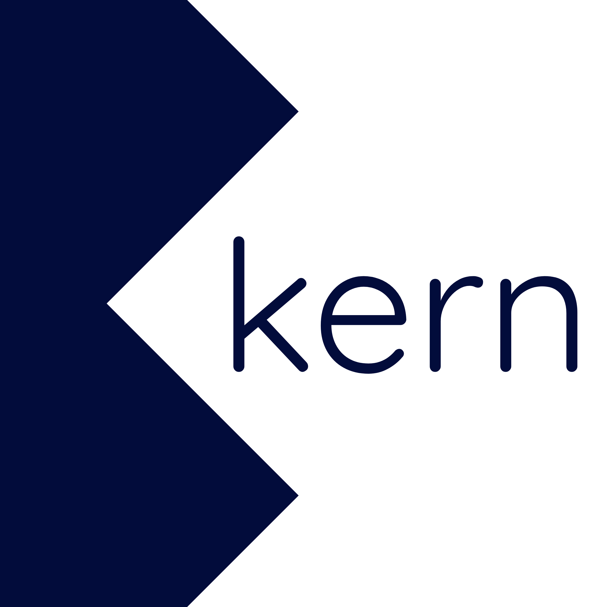

<p align="center">
  
</p>

# Kern

<!-- Language & platform -->
[](https://kotlinlang.org/)
[](https://openjdk.org/)
[](https://developer.android.com/)
<!-- UI -->
[](https://developer.android.com/jetpack/compose)
[](https://m3.material.io/)
[](https://developer.android.com/jetpack/compose/navigation)
<!-- Build & libraries -->
[](https://gradle.org/)
[](https://developer.android.com/build/releases/gradle-plugin)
[](https://poi.apache.org/)
[](https://opencsv.sourceforge.net/)
[](https://jsoup.org/)
<!-- PDF -->
<!-- Viewing uses Android's own PdfRenderer; the native bridge is a pure-lopdf tool
     crate (merge/split), not a MuPDF renderer. Qyra has no shields.io logo. -->
[](https://github.com/zParik/Qyra)
<!-- Project -->
[](#versioning)
[](LICENSE)
[](.)

A privacy-first, fully offline, open-source Android document toolkit.
No cloud sync. No data collection. No network access. Completely free. AGPL-3.0.

Kern is in early alpha.

> **This repository is the HMX Docs working copy.** It is the upstream Kern source
> at tag `0.1.11.0` (AGPL-3.0, © Sricharan Suresh) with Phase 1 build/CI work on
> top. The app itself is still branded and named Kern; product renaming is a later
> phase. HMX Docs stays AGPL-3.0 and source-available - see
> [docs/decisions/0001](docs/decisions/0001-licensing-and-distribution.md) - and the
> roadmap is in [docs/hmx-docs-audit-and-roadmap.md](docs/hmx-docs-audit-and-roadmap.md).

## What Kern does

Kern integrates with Android's "Open with" system, so any file on your device - in Downloads, Documents, or anywhere else - can be opened directly in Kern. There is no separate app folder and no syncing. Kern reads and writes files in place; your files stay yours, on your device.

## Document formats

Kern works with common document types:

- Spreadsheets - `.xlsx`, `.xls`, `.csv`
- Documents - `.docx`
- Presentations - `.pptx`
- PDF - `.pdf`
- EPUB - `.epub`

## Tech stack

- **Language:** Kotlin + Jetpack Compose
- **Office formats:** Apache POI (xlsx, docx, pptx) + OpenCSV
- **PDF viewing:** Android framework `PdfRenderer` (no native code)
- **PDF tools** (merge, split): [Qyra](https://github.com/zParik/Qyra) Rust JNI/NDK bridge, pure `lopdf` (GPL-3.0)
- **License:** AGPL-3.0
- **Min Android API:** 26 (Android 8.0+)

## Permissions

Kern requests:
- `READ_EXTERNAL_STORAGE` / `WRITE_EXTERNAL_STORAGE` (older Android versions)
- `READ_MEDIA_*` (Android 13+)
- `MANAGE_EXTERNAL_STORAGE` - guided toward Documents and Downloads
- "Open with" intent filters for supported document types

No network permissions. Ever.

## Project structure

```
kern/
├── src/
│   ├── browser/          # File browser + "Open with" intent handling
│   ├── editors/          # One module per format (csv, excel, word, pdf, pptx, epub)
│   ├── pdf-bridge/       # Native PDF bridge (JNI/NDK)
│   ├── settings/         # Settings screens
│   └── shared/           # Theme, shared UI, document IO
├── res/                  # Android resources (launcher icon, themes, strings)
├── tests/                # Mirrors src/ structure
├── docs/                 # Architecture notes, audit and roadmap
├── brand/                # Logo assets
├── config/               # Lint configuration
├── scripts/              # Dev tooling
└── sample-files/         # Sample documents
```

## Versioning

This project uses an `A.B.C.D` version scheme (`versionName` in `build.gradle.kts`).
Released versions are tagged in git. This repository currently carries
`0.1.11.0`, imported from upstream Kern, and has no release tags of its own yet.

## Building

The toolchain is pinned and reproducible: **JDK 17**, **Gradle 8.10.2** (through the
committed Gradle wrapper, checksum-verified in
`gradle/wrapper/gradle-wrapper.properties`), **Android SDK platform 35** with
**build-tools 35.0.0**, Kotlin 2.0.21, AGP 8.7.2.

```bash
# JVM unit tests (fastest signal; no native code involved)
./gradlew testDebugUnitTest

# Android Lint (config/lint.xml treats any network API use as an error)
./gradlew lintDebug

# Debug APK -> build/outputs/apk/debug/Kern-debug.apk
./gradlew assembleDebug

# Release APK, R8 + resource shrinking -> build/outputs/apk/release/Kern-release-unsigned.apk
./gradlew assembleRelease
```

You need a JDK 17 and an Android SDK (platform 35, build-tools 35.0.0) on the
machine doing the build; Gradle itself is downloaded by the wrapper, so it never
has to be installed by hand. CI has all of that already.

**The PDF bridge is optional for a build.** `assembleDebug` only ships working PDF
merge/split tools if `jniLibs/<abi>/libkern_pdf.so` exists; without it those tools
degrade gracefully (`QyraPdf.available` is false). CI builds the bridge from a
pinned Qyra commit - see [src/pdf-bridge/README.md](src/pdf-bridge/README.md).

### Debug vs release APK

| | Debug | Release |
|---|---|---|
| Task | `assembleDebug` | `assembleRelease` |
| File | `Kern-debug.apk` | `Kern-release-unsigned.apk` |
| Signed | yes, auto-generated debug key | **no - unsigned** |
| R8 / shrinking | off | on (mapping in `build/outputs/mapping/release/`) |

The release APK is deliberately left **unsigned**: the project has no release
signing key. An unsigned APK **cannot be installed on a device** — it must be
signed first (`apksigner sign`) with a key you control. It is produced so the
release configuration (R8, shrinking, ProGuard rules) is actually exercised and
so the exact shrink output can be inspected.

This repository does not publish releases. Builds are produced by GitHub Actions:
open the **Actions** tab, pick a run, and download the
`kern-debug-apk-<commit sha>` or `kern-release-unsigned-apk-<commit sha>`
artifact. Each artifact contains a `SHA256SUMS.txt`.

[CONTRIBUTING.md](CONTRIBUTING.md) covers contributor guidelines.

## License

Copyright © 2026 Sricharan Suresh (github.com/verycareful)

Kern is licensed under the **[GNU Affero General Public License v3.0](https://www.gnu.org/licenses/agpl-3.0.html)**.
You may use, study, modify and redistribute it freely. Any derivative work must
also be released under AGPL-3.0, including its source. Unlike the plain GPL, the
AGPL extends that obligation to network use: if you run a modified version and
let others interact with it over a network, you must offer them the source of
your modified version.

Kern requests no network permissions, so the network clause is unlikely to bite
in normal use. It applies to anyone who forks Kern and adds networking.

See the [LICENSE](LICENSE) file for the full license text.

**PDF tooling:** viewing uses Android's framework `PdfRenderer`. Merge and split
go through the [Qyra](https://github.com/zParik/Qyra) Rust JNI/NDK bridge
(`src/pdf-bridge/`, pure `lopdf`, no MuPDF), licensed GPL-3.0. GPL-3.0 code inside
an AGPL-3.0 project is compatible; both license headers are present in
`src/pdf-bridge/QyraPdf.kt`.
